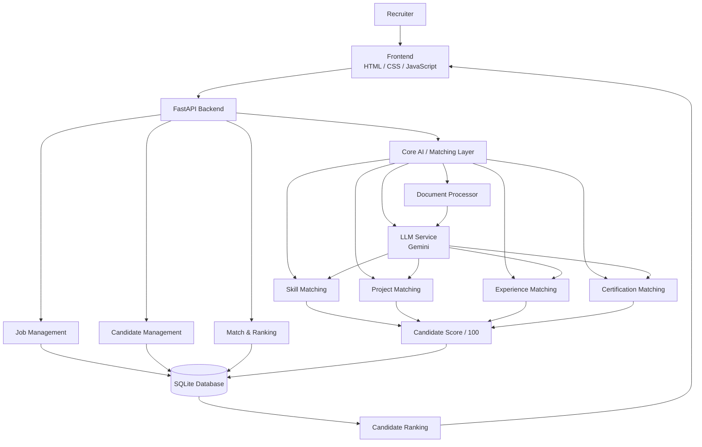

# AI Recruiter Platform

This project is about developing an **AI Recruiter Platform** for recruiters to manage their dashboard and easily shortlist candidates based on their resumes corresponding to the job description.

## The Problem

- Managing many applications can be time consuming.
- It often includes human bias.

## The Solution

AI-based screening that ranks candidates based on their score out of 100 for a particular job description and helps in real-time shortlisting.

---

## Features

- **AI-based screening:** Extracts relevant information from job descriptions and resumes.
- **Candidate ranking:** Ranks candidates based on their calculated scores.
- **Deterministic scoring:** Uses predefined weights for consistent candidate evaluation.
- **LLM-powered extraction:** Uses Google Gemini to understand unstructured job descriptions and resumes.
- **Detailed score breakdown:** Shows candidate performance across individual matching criteria.
- **Job management:** Create and manage job descriptions.
- **Candidate management:** Upload and manage candidate resumes.
- **REST API:** FastAPI endpoints for job, candidate, matching, and ranking operations.
- **PostgreSQL persistence:** Stores application data in a relational database.
- **Docker support:** Run the backend in a container for local development and testing.

---

## Tech Stack

| Component | Technologies |
|---|---|
| Frontend | HTML, CSS, JavaScript |
| Backend | Python, FastAPI, Uvicorn |
| Database | PostgreSQL |
| ORM | SQLAlchemy |
| Database Migrations | Alembic |
| LLM | Google Gemini API |
| Document Processing | PyMuPDF, python-docx |
| Configuration | Pydantic Settings |
| Containerization | Docker, Docker Compose |
| Frontend Deployment | Vercel |
| Backend Deployment | Render |
| Production Database | Neon PostgreSQL |

---

## Architecture



---

## Candidate Scoring System

Candidates are evaluated using a weighted scoring system with a maximum score of 100.

| Criterion | Weight |
|---|---:|
| Required Skills | 25% |
| Preferred Skills | 15% |
| Projects | 40% |
| Experience | 15% |
| Certifications | 5% |
| **Total** | **100%** |

The LLM extracts structured information from resumes and job descriptions. Matching services evaluate candidates using predefined scoring criteria.

Education information may be extracted, but it is not included in the final score.

The platform assists recruiters in prioritizing candidates; the scores should support, not replace, human review.

---

## Project Structure

AI-Recruiter-Platform/
│
├── backend/
│   ├── models/
│   │   ├── candidate.py
│   │   ├── job_model.py
│   │   └── matches.py
│   │
│   ├── routes/
│   │   ├── candidates.py
│   │   ├── jobs.py
│   │   ├── matches.py
│   │   └── ranking.py
│   │
│   ├── schemas/
│   │   ├── candidate_schema.py
│   │   ├── job_schema.py
│   │   └── match_schema.py
│   │
│   ├── services/
│   │   ├── candidate_service.py
│   │   ├── document_service.py
│   │   └── jd_service.py
│   │
│   ├── database.py
│   └── create_tables.py
│
├── core/
│   ├── candidate_ranking_service.py
│   ├── candidate_scoring_service.py
│   ├── certification_matching_service.py
│   ├── document_processor.py
│   ├── education_matching_service.py
│   ├── embeddings_service.py
│   ├── experience_matching_service.py
│   ├── llm_service.py
│   ├── normalization_service.py
│   ├── project_matching_service.py
│   └── skill_matching_service.py
│
├── frontend/
│   ├── index.html
│   ├── jobs.html
│   ├── create-job.html
│   ├── add-candidate.html
│   ├── script.js
│   └── style.css
│
├── uploads/
│   ├── jds/
│   └── resumes/
│
|
├── data/
|
├──schemas/
|   |── candidate.py
|   |── job.py
|
├── utils/
│   └── config.py
|   |- prompts.py
│
├── main.py
├── test.py
├── requirements.txt
├── .gitignore
└── README.md

---

````md
## Setup Guide

### Prerequisites

- Python 3.12 or a compatible version
- PostgreSQL
- Google Gemini API key
- Git
- Docker Desktop (optional, for containerized development)

### 1. Clone the Repository

```bash
git clone <YOUR_REPOSITORY_URL>
cd AI-Recruiter-Platform
```

### 2. Create a Virtual Environment

On Windows PowerShell:

```powershell
python -m venv venv
.\venv\Scripts\Activate.ps1
```

If PowerShell blocks activation, run:

```powershell
Set-ExecutionPolicy -ExecutionPolicy RemoteSigned -Scope Process
```

Install dependencies:

```powershell
pip install -r requirements.txt
```

### 3. Configure Environment Variables

Create a `.env` file in the project root:

```env
GEMINI_API_KEY=your_gemini_api_key
DATABASE_URL=your_local_postgresql_connection_string
DOCKER_DATABASE_URL=your_docker_postgresql_connection_string
```

For local development, `DATABASE_URL` points to local PostgreSQL. For Docker, `DOCKER_DATABASE_URL` points to the same PostgreSQL server through `host.docker.internal`.

Never commit `.env` or expose API keys and database credentials publicly.

### 4. Initialize the Database

Ensure PostgreSQL is running and your local database exists.

Create missing tables using the existing script:

```powershell
python -c "from backend.create_tables import *"
```

Verify that `DATABASE_URL` points to your intended local database before running the command.

Alembic is configured for schema migrations, but its initial migration history still needs cleanup before it can reliably initialize a fresh database from scratch.

### 5. Run the Backend

```powershell
uvicorn main:app --reload
```

Backend: `http://localhost:8000`

API documentation: `http://localhost:8000/docs`

### 6. Run the Frontend

Open the `frontend` directory in VS Code and use Live Server or another static web server.

Ensure the frontend API base URL points to the local FastAPI backend during development.

---

## Running with Docker

Docker is used to run the FastAPI backend in a container for local development and testing. PostgreSQL remains installed on the Windows host.

### Start the Backend

```powershell
docker compose up --build
```

Run in the background:

```powershell
docker compose up --build -d
```

Check container status:

```powershell
docker compose ps
```

View logs:

```powershell
docker compose logs -f backend
```

Stop the containers:

```powershell
docker compose down
```

The backend is available at `http://localhost:8000`, with API documentation at `http://localhost:8000/docs`.

### Database Configuration

- Local Python uses `DATABASE_URL`.
- Docker Compose maps `DOCKER_DATABASE_URL` to the container's `DATABASE_URL`.
- Render uses its own `DATABASE_URL`, pointing to Neon PostgreSQL.

Inside a container, `localhost` refers to the container itself. Use `host.docker.internal` to connect to PostgreSQL running on the Windows host.

---

## Deployment

The application is deployed using the following services:

| Service | Purpose |
|---|---|
| Vercel | Hosts the frontend |
| Render | Runs the FastAPI backend |
| Neon | Hosts the production PostgreSQL database |

### Render Environment Variables

Configure the following variables in the Render service:

- `GEMINI_API_KEY`: Google Gemini API key.
- `DATABASE_URL`: Neon PostgreSQL connection string.

The production backend uses Render's Python runtime. Docker is currently used for local development and testing.

The frontend must use the deployed Render backend URL rather than `localhost`.

Ensure the required database tables exist in Neon before using database-dependent features.

---

## Limitations

- Candidate strengths and weaknesses are not yet comprehensively explained in the score breakdown.
- Education is extracted but is not included in the final scoring system.
- The platform does not currently use an agentic architecture.
- Matching quality depends on the accuracy of extracted information and predefined scoring rules.
- Uploaded files stored on a server's local filesystem may not persist across redeployments or instance replacements.
- Alembic's migration history needs cleanup before fresh database initialization can be reliably automated.

---

## Future Improvements

- Add configurable experience and eligibility filters.
- Generate detailed candidate strength and weakness explanations.
- Improve semantic matching and evaluate ranking quality.
- Explore an agentic architecture for dynamic recruitment workflows.
- Add persistent object storage for uploaded resumes and job descriptions.
- Expand automated tests for API endpoints, scoring logic, and database operations.
- Improve error handling, logging, and production monitoring.
- Establish a reliable Alembic migration workflow for new database environments.
- Evaluate consistency, fairness, and reliability of candidate rankings.


